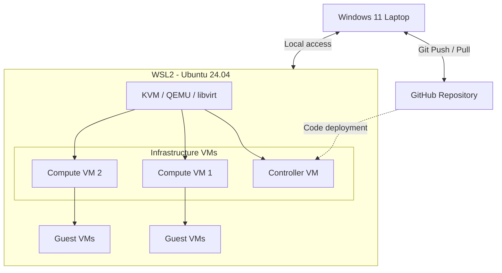

# Local WSL2 Deployment Architecture

## Deployment Notes

- Windows 11 runs WSL2 with Ubuntu 24.04.
- KVM, QEMU and libvirt provide host-level virtualization.
- One Controller VM manages two Compute VMs.
- The Controller monitors Compute resources and schedules guest VM placement.
- Compute VMs create and manage guest VMs using KVM and libvirt.
- GitHub stores the project source code.
- Nested KVM virtualization is enabled on Compute VMs, with local SSH port forwarding (`2221`–`2299`) providing direct guest access.
